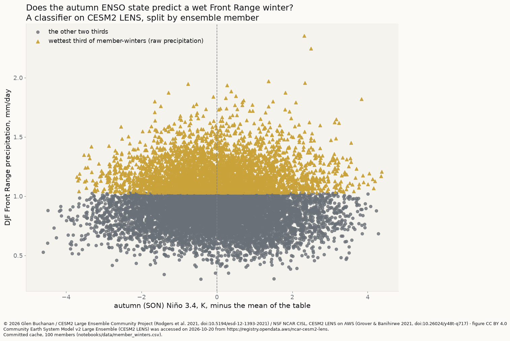

# CESM2 LENS ML Readiness Cookbook



[](https://binder.projectpythia.org/v2/gh/glenbuchanan/cesm2-lens-ml-readiness-cookbook/main?labpath=notebooks)

This Project Pythia Cookbook covers _supervised machine learning readiness on a climate-model large ensemble_: one classification
question — **does the autumn ENSO state predict a wet Front Range winter?** — answered on NSF NCAR's own
[CESM2 Large Ensemble](https://registry.opendata.aws/ncar-cesm2-lens/) (the AWS Open Data copy; no account, free egress),
walked along the analysis spine of NSF Unidata's
[*Supervised Machine Learning Readiness*](https://github.com/Unidata/supervised-ml-readiness) course.

This cookbook is for Earth system scientists, engineers and software staff who are new to machine learning, or who use it
without training. It assumes Python at the level of the [Xarray tutorial](https://tutorial.xarray.dev/) and no ML.
Time to learn: see the reading-time line in the notebook's Prerequisites cell; about two minutes running from the committed cache,
plus a one-time data derivation only if you re-derive the table (the one full run took 33 minutes on a fast link; on home
broadband expect an hour or more).

## Motivation

The existing [CESM LENS on AWS Cookbook](https://projectpythia.org/cesm-lens-aws-cookbook/) covers reading and analysing the
40-member CESM1 Large Ensemble with Xarray and Dask; the [scikit-learn Argo](https://projectpythia.org/sklearn-argo-cookbook/),
[Landsat ML](https://projectpythia.org/landsat-ml-cookbook/) and [xbatcher ML](https://projectpythia.org/xbatcher-ML-1-cookbook/)
cookbooks apply machine learning to ocean profiles, satellite imagery and CNN training batches, and the
[EO Data Science](https://projectpythia.org/eo-datascience-cookbook/) cookbook includes a supervised classifier on Sentinel-2 imagery. None yet walks a newcomer through
a supervised classifier on a **large ensemble**, where the members themselves are the unit the split has to respect. This cookbook teaches the whole spine on that data and changes
exactly one of Unidata's steps on purpose: the split is **by ensemble member**. Two reasons hold it there. The question is about
members the model has never seen, so the score has to come from unseen members. And the forced-response curve and the wet
threshold are fit on training members only, refit inside every validation fold, so no held-out member helps fit the transforms
that label it. What a member-blind split, or a transform fit before the split, would do to the score is not assumed: the notebook
scores the same model all three ways and prints the gaps against their per-fold spread. The same honesty runs to the end: a refinement trial
is promoted only on a corrected paired test, with the Bonferroni line printed beside it; the
held-out test runs only when you set `FINAL = True` after your last trial, and the notebook teaches you to report that result plainly,
including when nothing beats the base rate.

By the end you will be able to:

- explain the steps of a supervised analysis (framing → data → split → train → validate → refine → test → justify) and name the failure each step guards against;
- build and validate a classification model on a climate-model ensemble, reporting precision, recall and a confusion matrix;
- compare refinement trials as a paired test across runs, so a gap inside the run-to-run spread is not read as a difference;
- justify the chosen model honestly on measured performance and cost, including when nothing beats the base rate.

## Authors

[Glen Buchanan](https://github.com/glenbuchanan)

### Contributors

See the [contributors graph](https://github.com/glenbuchanan/cesm2-lens-ml-readiness-cookbook/graphs/contributors).

The spine, handbook and rubric shape follow NSF Unidata's *Supervised Machine Learning Readiness* (Apache-2.0, NSF award #2319979),
authored by NSF Unidata with Metropolitan State University of Denver. One cell adapts scikit-learn's
"Statistical comparison of models using grid search" example (BSD-3-Clause), credited in place.

## Structure

This cookbook is one notebook with two companion documents. What each file is for, and what judges it:

| File | What you do with it | What scores it |
|---|---|---|
| `notebooks/02_applications.ipynb` | run the spine end to end: frame → data → split → train → validate → refine → test → justify; eleven numbered exercises point into the handbook | the build (`myst build --execute --html --strict`) and your own printed lines |
| `notebooks/handbook.md` | record one entry per exercise with the evidence pasted (a table, a printed line, a figure); no evidence pasted scores *Not yet* | `notebooks/rubric.md`, first by you, then by a trainer |
| `notebooks/rubric.md` | score each entry at three levels and roll the levels up per objective | the trainer's column in the handbook's self-score table |
| `notebooks/data/member_winters.csv` | the committed member-winter table the notebook reads instead of S3 | the notebook's own cache-header assertion |

### The notebook

`notebooks/02_applications.ipynb` — *A supervised classifier on CESM2 LENS*. Part 1 frames the question as a
decision. Part 2 locates the data through the `intake-esm` catalogue and fills a Metadata Document, explores the target and the
input, and splits by ensemble member. Part 3 climbs a three-rung ladder (logistic regression → decision tree → gradient boosting)
against the base rate and a one-rule classifier; validates with a confusion matrix, precision and recall; runs refinement trials
as a paired test; tests once; and ends with a written justification.
**What to expect.** On the committed table the answer comes out close to *no*: the Niño-sign rule's precision sits below the
base rate, no rung's sits clearly above it, and the one trial the register promotes clears only the uncorrected test, not the
multiple-comparison line. The held-out test is left for the learner to run once. The notebook says so up front and treats it as
the result. It is a model-world study (CESM2 winters scored against CESM2 winters, never against observations, with CESM2's own
ENSO and teleconnection) on a ~1° grid that smooths the Front Range's orography, so a null here is not a null for the real Front
Range; the Summary names the next change that could test that.

The notebook stands on its own. It is also the classical-ML half of a longer open-source introduction to machine learning for NSF
NCAR staff ([ncar-ml-readiness-course](https://github.com/glenbuchanan/ncar-ml-readiness-course)), which keeps the file's
number; nothing in that repository is needed here.

### Data

`notebooks/data/member_winters.csv` is the **full** member-winter table (50 members per forcing half, every member of the
ensemble), derived by the notebook itself and committed (about 0.7 MB), so the book builds without touching S3 for the heavy step.
The notebook asserts the cache header against its parameter cell before reading it, and re-derives the table from S3 when
`REBUILD = True` (the one full derivation took 33 minutes on a fast link; on home broadband expect an hour or more). See
`notebooks/data/README.md`.

## Data citation

Community Earth System Model v2 Large Ensemble (CESM2 LENS) was accessed on 2026-10-20 from https://registry.opendata.aws/ncar-cesm2-lens.
The citation NSF NCAR's Data Citation section requires, and which the UCAR Data Terms of Use (CC BY 4.0) bind users to, is both
the AWS subset's DOI and the paper:

- Grover, M., & Banihirwe, A. (2021). *NCAR CESM2 Large Ensemble Cloud-Optimized Dataset*. NSF NCAR CISL. https://doi.org/10.26024/y48t-q717
- Rodgers, K. B. et al. (2021). Ubiquity of human-induced changes in climate variability. *Earth System Dynamics* 12, 1393–1411. https://doi.org/10.5194/esd-12-1393-2021

Results based on the CESM2 Large Ensemble acknowledge the CESM2 Large Ensemble Community Project and supercomputing resources
provided by the IBS Center for Climate Physics in South Korea. The same line sits under every figure the notebook draws.

## Running the Notebooks

You can either run the notebooks in the Cookbook using [Binder](https://binder.projectpythia.org/) or on your local machine.

### Running on Binder

The simplest way to interact with a Jupyter Notebook is through
[Binder](https://binder.projectpythia.org/), which enables "one click"
execution in the cloud. Simply navigate your mouse to
the top right corner of the book chapter you are viewing and click
on the rocket ship icon (see screenshots [here](https://foundations.projectpythia.org/preamble/how-to-use/#running-pythia-foundations-examples)),
and a text box will appear. Type or paste the Pythia Binder link
(`https://binder.projectpythia.org`) and click "Launch".
After a few moments you should be presented with a
notebook that you can interact with. You’ll be able to execute code
and even change the example programs. At first the code cells
have no output, until you execute them by pressing
{kbd}`Shift`\+{kbd}`Enter`. Complete details on how to interact with
a live Jupyter notebook are described in the Pythia Foundations chapter [Getting Started with
Jupyter](https://foundations.projectpythia.org/foundations/getting-started-jupyter).

Note, not all Cookbook chapters are executable. If you do not see
the rocket ship icon, such as on this page, you are not viewing an
executable book chapter.

### Running on Your Own Machine

If you are interested in running this material locally on your computer, you will need to follow this workflow:

1. Clone the `https://github.com/glenbuchanan/cesm2-lens-ml-readiness-cookbook` repository:

   ```bash
    git clone https://github.com/glenbuchanan/cesm2-lens-ml-readiness-cookbook.git
   ```

1. Move into the `cesm2-lens-ml-readiness-cookbook` directory
   ```bash
   cd cesm2-lens-ml-readiness-cookbook
   ```
1. Create and activate your conda environment from the `environment.yml` file
   ```bash
   conda env create -f environment.yml
   conda activate cesm2-lens-ml-readiness-cookbook-dev
   ```
1. Move into the `notebooks` directory and start up Jupyterlab
   ```bash
   cd notebooks/
   jupyter lab
   ```

### Running on the NSF NCAR JupyterHub

On the NSF NCAR JupyterHub (Casper/Derecho) create the same environment from `environment.yml` and pick the kernel it registers;
the notebook reads the AWS copy of the ensemble, so no GLADE path is needed.

## Licence, provenance and review status

- Code is Apache-2.0; non-code content is CC BY 4.0 (the Project Pythia split). Data are under the UCAR Data Terms of Use (CC BY 4.0).
- Nothing in this cookbook is export-controlled: open data, open code.
- Funding: self-funded. This cookbook has not been reviewed or sponsored by NSF NCAR, COMET or NSF Unidata; it is offered to the
  Project Pythia community for its own review.
- Drafting: Drafted with AI assistance (Anthropic's Claude) from cited sources, under the author's direction; the author's line-by-line edit and a subject-matter review are still to come.
